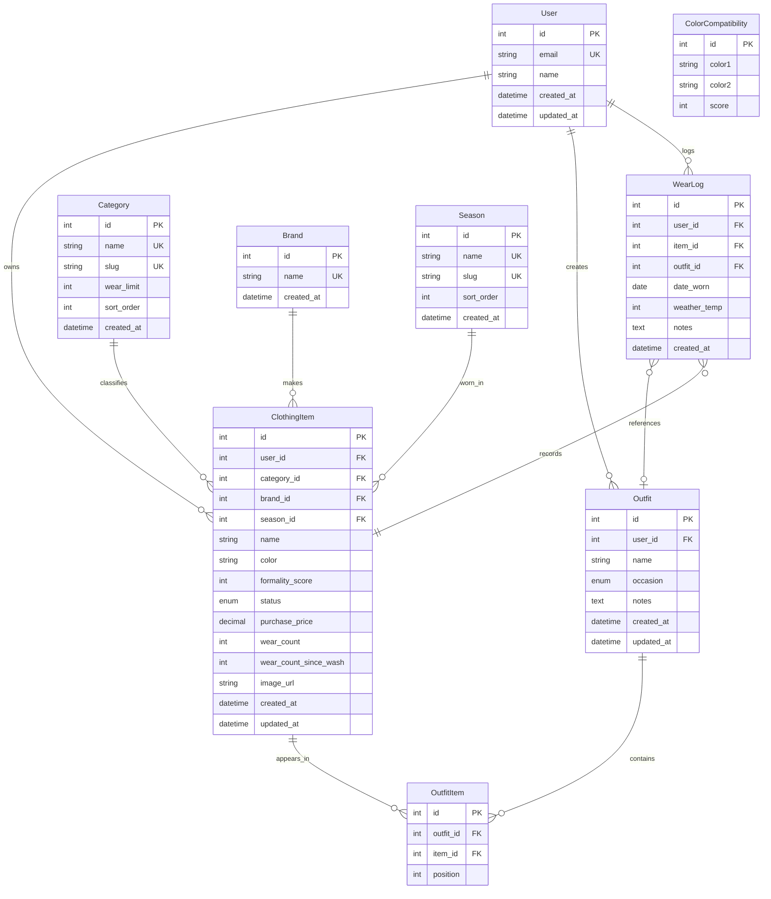

# Experiment 1 — Project Report

## 1. Project Title

**Digital Wardrobe — A Personal Wardrobe & Outfit Recommendation System**

A full-stack web application that lets users catalogue their clothing, manage laundry, and generate colour-coordinated outfit combinations from their own wardrobe.

## 2. Problem Statement

Managing a personal wardrobe is difficult without a dedicated tool. People forget what they own, re-buy items they already have, struggle to match colours, and cannot keep track of when clothes need washing. Existing solutions are either manual (spreadsheets, memory) or generic and do not factor in colour harmony, formality, seasons, or the cleanliness of each item.

A digital wardrobe system is required that:
- Stores clothing items with category, colour, formality, brand, season, and price.
- Tracks each item's cleanliness and wash cycle.
- Recommends outfit combinations that are colour-harmonious and available (clean) in the wardrobe.
- Provides analytics such as cost-per-wear, wardrobe value, and wear history.

## 3. Objective

The objectives of this project are to:

1. Design and build a relational database that models users, clothing items, brands, seasons, categories, outfits, and wear history.
2. Develop a full-stack web application (Reflex + Python + MySQL) for CRUD operations on wardrobe items.
3. Implement a laundry-management module that auto-flags items needing a wash based on per-category wear limits.
4. Build an outfit recommendation engine that combines clean topwear, bottomwear, and footwear and filters combinations through a pre-computed colour-harmony matrix.
5. Provide analytics — cost-per-wear, total wardrobe value, season breakdown, and neglected-piece alerts.

## 4. ER Diagram

**Relationship summary**

| Relationship | Cardinality | Description |
| --- | --- | --- |
| User → ClothingItem | 1 : N | A user owns many clothing items |
| User → Outfit | 1 : N | A user creates many saved outfits |
| User → WearLog | 1 : N | A user has many wear-history entries |
| Category → ClothingItem | 1 : N | One category classifies many items |
| Brand → ClothingItem | 1 : N | One brand can appear on many items |
| Season → ClothingItem | 1 : N | One season applies to many items |
| Outfit → OutfitItem → ClothingItem | M : N | An outfit contains many items; an item appears in many outfits |
| ClothingItem → WearLog | 1 : N | Each wear is logged against one item |
| Outfit → WearLog | 0 : 1 | A wear entry may optionally reference a saved outfit |
| ColorCompatibility | — | Standalone colour-pair harmony matrix |

## 5. Tabular Form

### 5.1 User

| Column | Data Type | Constraint | Description |
| --- | --- | --- | --- |
| id | INT | PK | Unique user identifier |
| email | VARCHAR(255) | NOT NULL, UNIQUE | Login email |
| name | VARCHAR(120) | NULL | Display name |
| created_at | DATETIME | NOT NULL | Row creation time |
| updated_at | DATETIME | NOT NULL | Last update time |

### 5.2 Category

| Column | Data Type | Constraint | Description |
| --- | --- | --- | --- |
| id | INT | PK | Category identifier |
| name | VARCHAR(50) | NOT NULL, UNIQUE | e.g. Topwear, Footwear |
| slug | VARCHAR(50) | NOT NULL, UNIQUE | URL-friendly name |
| wear_limit | INT | NOT NULL | Wears before laundry is triggered |
| sort_order | INT | NOT NULL | Display order |
| created_at | DATETIME | NOT NULL | Row creation time |

### 5.3 Brand

| Column | Data Type | Constraint | Description |
| --- | --- | --- | --- |
| id | INT | PK | Brand identifier |
| name | VARCHAR(80) | NOT NULL, UNIQUE | Brand name |
| created_at | DATETIME | NOT NULL | Row creation time |

### 5.4 Season

| Column | Data Type | Constraint | Description |
| --- | --- | --- | --- |
| id | INT | PK | Season identifier |
| name | VARCHAR(30) | NOT NULL, UNIQUE | e.g. Summer, Winter |
| slug | VARCHAR(30) | NOT NULL, UNIQUE | URL-friendly name |
| sort_order | INT | NOT NULL | Display order |
| created_at | DATETIME | NOT NULL | Row creation time |

### 5.5 ClothingItem

| Column | Data Type | Constraint | Description |
| --- | --- | --- | --- |
| id | INT | PK | Item identifier |
| user_id | INT | NOT NULL, FK → User.id (CASCADE) | Owner |
| category_id | INT | NOT NULL, FK → Category.id (RESTRICT) | Item category |
| brand_id | INT | NULL, FK → Brand.id (SET NULL) | Item brand |
| season_id | INT | NULL, FK → Season.id (SET NULL) | Wearable season |
| name | VARCHAR(120) | NOT NULL | Item name |
| color | VARCHAR(30) | NOT NULL | Colour used by harmony matrix |
| formality_score | INT | NOT NULL | 1 = casual, 5 = formal |
| status | ENUM | NOT NULL | CLEAN / LAUNDRY |
| purchase_price | DECIMAL(10,2) | NOT NULL | Original price |
| wear_count | INT | NOT NULL | Total wears recorded |
| wear_count_since_wash | INT | NOT NULL | Wears since last wash |
| image_url | VARCHAR(500) | NULL | Photo URL |
| created_at | DATETIME | NOT NULL | Row creation time |
| updated_at | DATETIME | NOT NULL | Last update time |

### 5.6 Outfit

| Column | Data Type | Constraint | Description |
| --- | --- | --- | --- |
| id | INT | PK | Outfit identifier |
| user_id | INT | NOT NULL, FK → User.id (CASCADE) | Owner |
| name | VARCHAR(120) | NOT NULL | Outfit name |
| occasion | ENUM | NOT NULL | CASUAL / SMART_CASUAL / WORK / FORMAL |
| notes | TEXT | NULL | Extra notes |
| created_at | DATETIME | NOT NULL | Row creation time |
| updated_at | DATETIME | NOT NULL | Last update time |

### 5.7 OutfitItem (junction table)

| Column | Data Type | Constraint | Description |
| --- | --- | --- | --- |
| id | INT | PK | Junction row identifier |
| outfit_id | INT | NOT NULL, FK → Outfit.id (CASCADE) | Outfit reference |
| item_id | INT | NOT NULL, FK → ClothingItem.id (CASCADE) | Item reference |
| position | INT | NOT NULL | 1 = base, 2 = layering, 3 = footwear |

Unique constraint `(outfit_id, item_id)` prevents duplicate items in one outfit.

### 5.8 WearLog

| Column | Data Type | Constraint | Description |
| --- | --- | --- | --- |
| id | INT | PK | Wear entry identifier |
| user_id | INT | NOT NULL, FK → User.id (CASCADE) | Owner |
| item_id | INT | NOT NULL, FK → ClothingItem.id (CASCADE) | Item worn |
| outfit_id | INT | NULL, FK → Outfit.id (SET NULL) | Optional outfit |
| date_worn | DATE | NOT NULL | When it was worn |
| weather_temp | INT | NULL | Temperature context |
| notes | TEXT | NULL | Comments |
| created_at | DATETIME | NOT NULL | Row creation time |

### 5.9 ColorCompatibility

| Column | Data Type | Constraint | Description |
| --- | --- | --- | --- |
| id | INT | PK | Matrix row identifier |
| color1 | VARCHAR(30) | NOT NULL | First colour (≤ color2) |
| color2 | VARCHAR(30) | NOT NULL | Second colour |
| score | INT | NOT NULL | Harmony score 0–10 |

Unique constraint `(color1, color2)` stores each pair once; pairs are queried with `LEAST()` / `GREATEST()`.

## 6. Normalization & Denormalization Analysis

### 6.1 BCNF Verification of Existing Schema

A relation $R$ is in Boyce-Codd Normal Form (BCNF) if for every non-trivial functional dependency $X \to Y$, $X$ is a superkey of $R$.

| Table | Candidate Keys | Functional Dependencies | BCNF Status | Evaluation |
|---|---|---|---|---|
| **User** | `id`, `email` | `id → email, name, password_hash, created_at, updated_at` `email → id, name, ...` | **In BCNF** | Core entity. Determinants are superkeys. Keep normalized. |
| **Category** | `id`, `name`, `slug` | `id → name, slug, wear_limit, sort_order` `name → wear_limit, sort_order` | **In BCNF** | Holds business rules (`wear_limit`) independent of individual clothes. Keep normalized to avoid update anomalies. |
| **Brand** | `id`, `name` | `id ↔ name` | **In BCNF** | Single-attribute lookup table. Over-normalized; causes unnecessary joins. |
| **Season** | `id`, `name`, `slug` | `id ↔ (name, slug, sort_order)` | **In BCNF** | Fixed, static domain (4 rows). Over-normalized; causes unnecessary joins. |
| **ClothingItem** | `id` | `id → user_id, category_id, name, color, price...` | **In BCNF** | Core inventory entity. |
| **Outfit** | `id` | `id → user_id, name, occasion, notes...` | **In BCNF** | Determinant is primary key. Keep normalized. |
| **OutfitItem** | `(outfit_id, item_id)` | `(outfit_id, item_id) → id, position` | **In BCNF** | Junction table modeling M:N relationship. Keep normalized. |
| **WearLog** | `id` | `id → user_id, item_id, date_worn, notes...` | **In BCNF** | Historical event log. Keep normalized. |
| **ColorCompatibility** | `(color1, color2)` | `(color1, color2) → score` | **In BCNF** | Lookup matrix of pairwise scores. Keep normalized. |

### 6.2 Why Pure BCNF is Worse for Certain Tables

While normalization eliminates redundancy, forcing **every** table into strict BCNF incurs severe performance and development penalties:

1. **Brand (Single-Attribute Lookup Table Overhead):**
   - In pure BCNF, brand was split into `Brand(id, name)` so brand names wouldn't repeat in `ClothingItem`.
   - *Problem:* `Brand` has **no other descriptive attributes** (no country, website, logo). Every inventory view was forced to perform a `LEFT JOIN Brand ON Brand.id = ClothingItem.brand_id`.
   - *Insertion Penalty:* Creating a piece required a 3-step sequence: `SELECT FROM Brand`, if missing `INSERT INTO Brand`, commit & refresh, then insert item.
   - *Denormalization Decision:* Store `brand VARCHAR(80)` directly on `ClothingItem`. Eliminates 1 table join on every inventory load and eliminates insert roundtrips.

2. **Season (Static Low-Cardinality Domain):**
   - The wardrobe supports only 4 static seasons (`Summer`, `Winter`, `Rainy`, `Spring`).
   - *Problem:* Normalizing 4 fixed strings into an independent relation with foreign keys, indexes, and an outer join on every read adds unnecessary schema complexity for static categorical metadata.
   - *Denormalization Decision:* Store `season VARCHAR(30)` directly on `ClothingItem`.

3. **ClothingItem Derived Status vs. WearLog (Aggregation Bottleneck):**
   - In strict 3NF/BCNF, summary metrics (`wear_count = COUNT(WearLog)`) and cleanliness status (`CLEAN` vs `LAUNDRY`) are functionally dependent on the aggregation of `WearLog` and `Category.wear_limit`.
   - *Problem:* Computing these on every read forces expensive `GROUP BY` subqueries across `WearLog`. During outfit recommendation (which cross-joins tops, bottoms, and footwear), evaluating cleanliness dynamically turns the query into an $O(N^3)$ aggregate subquery bottleneck.
   - *Denormalization Decision:* Maintain denormalized `wear_count`, `wear_count_since_wash`, and `status` directly on `ClothingItem`, synchronized during wear logging and laundry toggling.

### 6.3 Summary of Decisions

| Table / Feature | Original Form | Target Form | Justification |
|---|---|---|---|
| **Brand** | Normalized BCNF Table | Denormalized into `ClothingItem.brand` | Eliminates redundant `LEFT JOIN` and lookup overhead on zero-attribute entity. |
| **Season** | Normalized BCNF Table | Denormalized into `ClothingItem.season` | Static 4-item domain; eliminates join indirection. |
| **Wear Counters & Status** | Dynamic Aggregates (Strict 3NF) | Denormalized into `ClothingItem` | Drastically optimizes dashboard loads and $O(N^3)$ outfit generation. |
| **Category** | Normalized BCNF Table | **Retain BCNF** | Stores business logic (`wear_limit`); denormalizing would cause update anomalies. |
| **OutfitItem** | Normalized BCNF Table | **Retain BCNF** | Junction table needed for M:N foreign key cascades and relational integrity. |
| **User, WearLog, ColorCompatibility** | Normalized BCNF Tables | **Retain BCNF** | Core entities, time-series events, and pair lookup matrix. |

